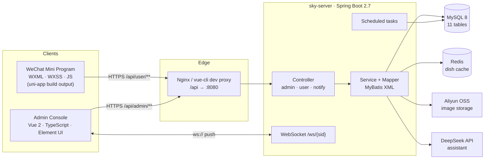
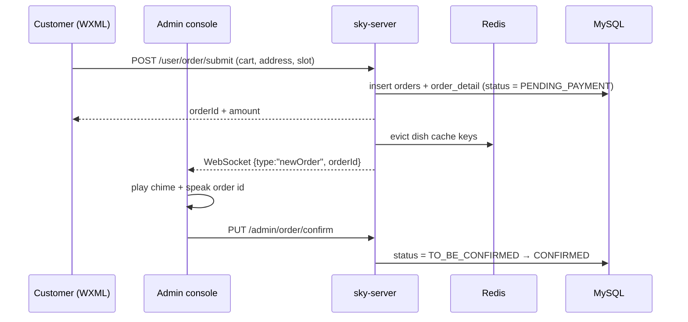
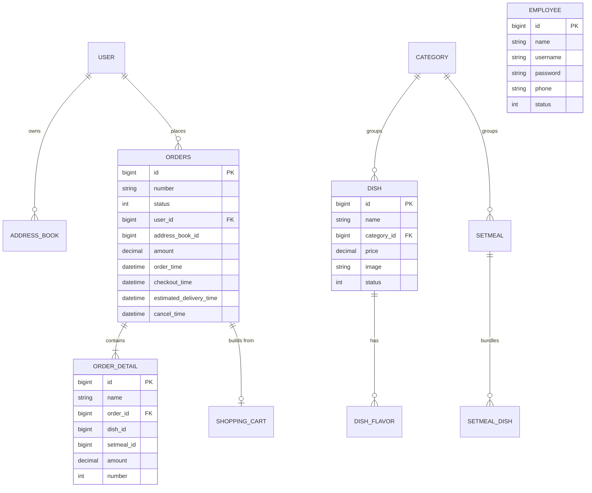

<div align="center">

# 智点外卖 · ZhiDian Takeout

**A full-stack food-delivery system designed end to end — from product documents and an interactive prototype to a Vue admin console, a WeChat mini program written in WXML, and a Spring Boot service.**

[](https://vuejs.org/)
[](https://www.typescriptlang.org/)
[](https://spring.io/projects/spring-boot)
[](https://www.mysql.com/)
[](https://developers.weixin.qq.com/miniprogram/dev/framework/)
[](LICENSE)

**English** · [简体中文](README.zh-CN.md)

[Overview](#-overview) · [Features](#-features) · [Architecture](#-architecture) · [Screens](#-screens) · [Quick start](#-quick-start) · [Configuration](#-configuration) · [Design notes](#-design-notes) · [Data model](#-data-model) · [FAQ](#-faq)

</div>

<p align="center">
  
  
</p>

---

## 📌 Overview

Most student delivery projects stop at "it runs on my machine". This repository is organised as a
product: the requirements work, the interaction design, the two clients and the service that backs
them all live side by side, and every layer is documented well enough that someone else can pick it
up without asking questions.

The system has two faces of the same marketplace:

| Actor | Client | What they do |
| :-- | :-- | :-- |
| **Customer** | WeChat mini program (`miniprogram/`, WXML/WXSS) | Browse the menu, pick dish specs, build a cart, choose delivery time, place and pay for an order, track it, reorder |
| **Merchant** | Admin console (`admin-web/`, Vue 2 + TypeScript) | Watch today's revenue, accept or reject incoming orders, dispatch riders, maintain dishes / set meals / categories / staff, read sales analytics, ask the built-in assistant |

The interesting part is not that a delivery app exists — it is **how the two clients agree on one
domain model** and how the small details (store open/closed state, dish spec prices, cart badge,
delivery time granularity, order state machine) are handled consistently across a Java service, a
browser console and a mini program.

<details>
<summary><b>What was actually built here (and what is scaffolding)</b></summary>

<br/>

- **Product layer** — `docs/product/` holds the BRD, MRD and PRD written for this system;
  `docs/prototype/` holds a 28 MB Axure prototype (user app + merchant console) with annotated
  states, page-flow diagrams and a feature map.
- **Clients** — the admin console is a Vue 2 / TypeScript application built on top of the
  open-source `vue-typescript-admin-template`; the pages, API modules, order workflow, statistics
  views, voice reminder and assistant view are this project's work.
- **Service** — `backend/` follows the `sky-take-out` (苍穹外卖) reference architecture, a widely used
  teaching codebase. Business modules, the order state machine, the scheduled jobs, the Redis cache
  invalidation and the assistant endpoint were extended here.
- **Mini program** — committed as a **compiled uni-app bundle** (`app.js`, `common/vendor.js`,
  `pages/**.wxml`). That is why the repository title says "Vue **and** WXML": the admin side is Vue,
  the customer side is WXML. It opens directly in WeChat DevTools with no build step.

Full credits are in [Acknowledgements](#-acknowledgements).

</details>

---

## ✨ Features

### Customer app — WeChat mini program

| Area | Behaviour |
| :-- | :-- |
| **Sign-in** | Silent `wx.login` → `code` exchanged for a JWT on the server; no password, no storage of openid on the device |
| **Store state** | Three home-page variants — *open*, *busy*, *closed* — driven by the shop status endpoint; ordering is blocked in the closed state |
| **Menu** | Categories on the left rail, dishes on the right; each dish can carry flavour options (spiciness, temperature, portion) whose price deltas are resolved before the cart is touched |
| **Cart** | Add / remove / clear, live quantity badge, per-spec line items, bottom bar recalculates the payable amount on every change |
| **Checkout** | Delivery address, **delivery-time picker** with 30-minute slots (today + tomorrow), remarks, cutlery count, invoice placeholder |
| **Payment** | Order created first, then a payment call; the success page is idempotent so a refresh cannot double-charge |
| **Orders** | Status tabs (unpaid / pending / delivering / completed / cancelled), cancel, urge, "order again" which refills the cart |
| **Profile** | Address book (create / edit / set default), history orders, contact-the-merchant entry |

### Merchant console — Vue admin

| Area | Behaviour |
| :-- | :-- |
| **Dashboard** | Today's revenue, valid orders, completion rate, average ticket, new users; order counters per state; dish and set-meal overview |
| **Order desk** | Filter by state, accept / reject with a reason, dispatch, cancel, inspect an order's items and address |
| **Menu management** | Dishes with image upload, category binding, price, sale status; set meals composed from dishes; category CRUD with sort order |
| **Staff** | Employee CRUD, account enable/disable, password reset |
| **Analytics** | Revenue, user growth, order volume and top-10 selling items over selectable ranges, rendered with ECharts |
| **Voice reminder** | A WebSocket connection in the layout shell plays a chime and speaks the new order id, so the desk does not need to watch the screen |
| **Assistant** | "智点问答" — a chat view backed by an LLM endpoint that receives the last 30 days of sales rankings as context |

### Service — Spring Boot

- Dual JWT channels (admin and customer) with separate secrets, headers and TTLs
- Redis-backed dish cache with pattern-based invalidation on every mutation
- WebSocket push for new orders, plus scheduled jobs for unpaid-order expiry and end-of-day cleanup
- Aliyun OSS upload, Apache POI report export, unified `Result<T>` envelope, global exception handler
- AOP-based audit-field filling (`@AutoFill`) driven by a `ThreadLocal` user context

---

## 🏗 Architecture



The three request paths worth understanding:



---

## 🧰 Tech stack

| Layer | Choices |
| :-- | :-- |
| Admin console | Vue 2.6, TypeScript 3.6, Element UI 2.12, Vuex + vuex-module-decorators, vue-router 3, axios, ECharts 5, SCSS, vue-cli 3 |
| Mini program | uni-app compiled output, WXML / WXSS / JS, WeChat DevTools 2.24 base library |
| Service | Java 8+, Spring Boot 2.7.3, MyBatis 2.2, Druid, PageHelper, Spring WebSocket, Spring Cache, Apache POI |
| Storage | MySQL 8.0 (utf8mb4), Redis (logical db 10), Aliyun OSS |
| Auth | JWT, two independent token channels |
| Assistants | DeepSeek `deepseek-chat`, OpenAI-compatible HTTP |
| Docs | BRD / MRD / PRD (docx), Axure RP interactive prototype |
| Build | Maven 3.6+, npm 6+, Node 14/16 |

---

## 📁 Repository layout

```
.
├── README.md                    ← you are here (English)
├── README.zh-CN.md              ← 简体中文版
├── LICENSE                      MIT, ours
├── THIRD-PARTY-NOTICES.md       upstream projects this one builds on
├── backend/                     Spring Boot service (Maven multi-module)
│   ├── pom.xml
│   ├── sky-common/              constants, exceptions, result envelope, utils
│   ├── sky-pojo/                entities, DTOs, VOs
│   └── sky-server/              controllers, services, mappers, tasks, websocket
│       └── src/main/resources/
│           ├── application.yml          profile switch + placeholder wiring
│           ├── application-dev.yml      all secrets read from env vars
│           ├── config.properties        assistant endpoint (placeholder key)
│           └── mapper/*.xml             11 MyBatis mappers
├── admin-web/                   Vue 2 + TypeScript merchant console
│   ├── src/api/                 10 typed API modules
│   ├── src/views/               dashboard, statistics, orders, dish, setmeal,
│   │                            category, employee, chat
│   ├── src/router.ts            meta-driven navigation
│   ├── src/utils/request.ts     axios wrapper (token, error handling)
│   └── .env.development         dev proxy → http://localhost:8080/admin
├── miniprogram/                 WeChat mini program (compiled uni-app bundle)
│   ├── pages/                   11 pages + Navbar component
│   ├── components/              shared UI blocks
│   └── project.config.json      appid placeholder: touristappid
├── database/
│   └── schema.sql               11 tables + demo seed (personal data masked)
└── docs/
    ├── images/                  screenshots used by this README
    ├── product/                 BRD / MRD / PRD
    └── prototype/               Axure prototype, open index.html in a browser
```

---

## 🖼 Screens

<table>
<tr>
<td width="50%"><br/><sub><b>Dish management</b> — search, sale status, batch actions</sub></td>
<td width="50%"><br/><sub><b>Checkout</b> — address, delivery slot, cutlery, invoice</sub></td>
</tr>
<tr>
<td><br/><sub><b>Product map</b> — both clients, drawn before any code</sub></td>
<td><br/><sub><b>Function tree</b> — the customer-side scope</sub></td>
</tr>
</table>

---

## 🚀 Quick start

You do not need all three parts to look at the project. Pick the row you care about:

| I want to… | Do this | Needs |
| :-- | :-- | :-- |
| Browse the design work | open `docs/prototype/智点外卖_用户端/index.html` in a browser | a browser |
| See the merchant console | steps 1 → 5 | Node + backend |
| Try the customer app | steps 1 → 4, then 6 | backend + WeChat DevTools |
| Read the requirements | open the three documents in `docs/product/` | Word / WPS |

### 0. Prerequisites

| Tool | Version | Notes |
| :-- | :-- | :-- |
| JDK | 8 or 11 | Spring Boot 2.7 also runs on 17, but 8/11 matches the pinned dependencies |
| Maven | 3.6+ | `mvn -v` |
| Node.js | 14 or 16 | vue-cli 3 and `node-sass`-era tooling dislike Node 18+ |
| MySQL | 8.0 | utf8mb4 |
| Redis | 5+ | no cluster needed |
| WeChat DevTools | 1.05+ | only for the mini program |

### 1. Clone

```bash
git clone https://github.com/wushaw1102/Design-and-Development-of-the-Zhidian-Food-Delivery-Based-on-Cangqiong-Food-Delivery-Framework.git
cd Design-and-Development-of-the-Zhidian-Food-Delivery-Based-on-Cangqiong-Food-Delivery-Framework
```

### 2. Create the database

```bash
mysql -u root -p -e "CREATE DATABASE IF NOT EXISTS sky_take_out DEFAULT CHARSET utf8mb4;"
mysql -u root -p sky_take_out < database/schema.sql
```

The seed contains 11 tables, 10 categories, 25 dishes and 25 orders, so the dashboard and analytics
views have something to draw on the first run. Every phone number, ID number and openid in the dump
is a placeholder — see [Security note](#-security-note).

### 3. Start Redis

```bash
redis-server            # or: docker run -p 6379:6379 redis:7-alpine
```

The service uses logical database **10**, configured by `SKY_REDIS_DATABASE`.

### 4. Point the service at your environment

Every credential is read from the environment; nothing sensitive lives in the repository.

```bash
# bash / Git Bash
export SKY_DB_PASSWORD=your-mysql-password
export SKY_REDIS_PASSWORD=
export SKY_OSS_ACCESS_KEY_ID=...        # optional: only for image upload
export SKY_OSS_ACCESS_KEY_SECRET=...
export SKY_OSS_BUCKET=...
export SKY_WECHAT_APPID=...             # optional: only for wx.login
export SKY_WECHAT_SECRET=...
```

```powershell
# PowerShell
$env:SKY_DB_PASSWORD = "your-mysql-password"
$env:SKY_REDIS_PASSWORD = ""
```

The assistant endpoint reads `backend/sky-server/src/main/resources/config.properties`; replace the
placeholder key there if you want the chat view to answer.

### 5. Run the backend, then the console

```bash
cd backend
mvn clean package -DskipTests
java -jar sky-server/target/sky-server-1.0-SNAPSHOT.jar
# → http://localhost:8080  (API docs: /doc.html)
```

```bash
cd admin-web
npm install
npm run serve
# → http://localhost:8888  (dev proxy /api → http://localhost:8080/admin)
```

Sign in with the seeded administrator account — `admin` / `123456` (the seed stores an MD5 hash; the
account is meant for local demos only).

### 6. Open the mini program

1. WeChat DevTools → **Import project** → choose `miniprogram/`
2. Use your own AppID, or keep `touristappid` for a local preview
3. Enable **不校验合法域名** (Details → Local settings) so `http://localhost:8080` is reachable
4. If your service is not on `localhost:8080`, edit `baseUrl` in `miniprogram/common/vendor.js`

The committed bundle is build output, so there is no `npm install` and no compile step on this side.

---

## ⚙️ Configuration

| Variable | Default | Used for |
| :-- | :-- | :-- |
| `SKY_DB_HOST` / `SKY_DB_PORT` | `localhost` / `3306` | MySQL endpoint |
| `SKY_DB_NAME` | `sky_take_out` | schema name |
| `SKY_DB_USER` / `SKY_DB_PASSWORD` | `root` / `change-me` | MySQL credentials |
| `SKY_REDIS_HOST` / `SKY_REDIS_PORT` | `localhost` / `6379` | Redis endpoint |
| `SKY_REDIS_PASSWORD` / `SKY_REDIS_DATABASE` | *(empty)* / `10` | Redis auth and logical db |
| `SKY_OSS_*` | *(empty)* | Aliyun OSS upload (dish images) |
| `SKY_WECHAT_APPID` / `SKY_WECHAT_SECRET` | *(empty)* | `wx.login` code exchange |
| `VUE_APP_URL` (admin) | `http://localhost:8080/admin` | dev proxy target |
| `VUE_APP_SOCKET_URL` (admin) | `ws://localhost:8080/ws/` | order push |

JWT secrets and TTLs stay in `application.yml` (`sky.jwt.*`) — rotate them before exposing the
service anywhere beyond localhost.

---

## 🔌 API surface

Nineteen controllers, grouped by channel:

| Channel | Prefix | Representative endpoints |
| :-- | :-- | :-- |
| Admin | `/admin/employee` | `POST /login`, `POST`, `GET /page`, `PUT`, `POST /status/{id}` |
| Admin | `/admin/category` | `GET /page`, `POST`, `PUT`, `DELETE`, `GET /list`, `POST /status/{id}` |
| Admin | `/admin/dish` | `GET /page`, `POST`, `PUT`, `DELETE`, `POST /status/{id}`, `GET /list` |
| Admin | `/admin/setmeal` | `GET /page`, `POST`, `PUT`, `DELETE`, `POST /status/{id}` |
| Admin | `/admin/order` | `GET /conditionSearch`, `GET /statistics`, `PUT /confirm`, `PUT /rejection`, `PUT /cancel`, `PUT /delivery/{id}`, `GET /details/{id}` |
| Admin | `/admin/workspace` | `GET /businessData`, `GET /overviewOrders`, `GET /overviewDishes`, `GET /overviewSetmeals` |
| Admin | `/admin/report` | `GET /turnoverStatistics`, `GET /userStatistics`, `GET /ordersStatistics`, `GET /top10`, `GET /export` |
| Admin | `/admin/chat` | `POST` — assistant query, receives sales context server-side |
| Admin | `/admin/common` | `POST /upload` — OSS upload |
| Customer | `/user/user` | `POST /login` (wx code), `GET /shop/status` |
| Customer | `/user/shoppingCart` | `POST /add`, `GET /list`, `POST /sub`, `DELETE /clean` |
| Customer | `/user/order` | `POST /submit`, `PUT /payment`, `GET /historyOrders`, `GET /orderDetail/{id}`, `PUT /cancel/{id}`, `POST /repetition/{id}`, `GET /reminder/{id}` |
| Customer | `/user/addressBook` | `GET /list`, `POST`, `PUT`, `DELETE /{id}`, `PUT /default` |
| Notify | `/notify/pay` | payment callback |

All responses share one envelope — `{ "code": 1, "msg": null, "data": ... }` — so the axios wrapper
and the mini program's request helper can treat failures identically.

---

## 🧠 Design notes

Six decisions that shaped the code more than any others.

**1 · Two independent token channels.** Admins and customers authenticate against different secrets,
different header names (`token` vs `authentication`) and different TTLs, enforced by two interceptors
in `config/WebMvcConfiguration`. A customer token can never reach an `/admin/**` route, even if the
front ends share a host.

**2 · Audit fields written once.** `@AutoFill` plus `AutoFillAspect` populate `create_time`,
`update_time`, `create_user` and `update_user` from the request thread's context. Business code never
passes them by hand, so inserts and updates stay consistent even when a new table is added.

**3 · Cache with a deliberate invalidation rule.** Dish lists are cached per category. Any write to a
dish, category or set meal evicts the matching key pattern rather than a single key — coarse on
purpose, because a stale menu is a much worse failure than one extra query.

**4 · Order push is a side channel, never the source of truth.** New orders are pushed over
WebSocket and announced by an `<audio>` element in the layout shell, but the desk still polls the
order list. If the socket drops, the workflow degrades to a refresh — it does not stall.

**5 · Time is a first-class part of the order model.** The customer picks a 30-minute delivery slot;
the service cancels unpaid orders fifteen minutes after creation and closes orders still marked as
delivering at 01:00. Both jobs are idempotent, so a restart cannot double-process a batch.

**6 · The assistant is grounded, not generative.** Before calling the model, `ChatServiceImpl`
queries the last 30 days of sales rankings and injects them as context. The prompt explicitly tells
the model to ignore that block when the question is unrelated — which keeps answers about "what sold
best" tied to the database instead of the model's imagination.

---

## 🗃 Data model



The order state machine is the piece that keeps the two clients in sync:

```
1 pending payment ──pay──▶ 2 to be confirmed ──accept──▶ 3 confirmed ──dispatch──▶ 4 delivering ──▶ 5 completed
        │                          │                          │
        └──timeout (15 min)──▶ 6 cancelled ◀──reject──────────┘
```

---

## 📦 Product documents & prototype

| Artifact | Path | What it contains |
| :-- | :-- | :-- |
| BRD | `docs/product/BRD-商业需求文档.docx` | Market context, business goals, stakeholder value |
| MRD | `docs/product/MRD-市场需求文档.docx` | Target users, competitor scan, demand analysis |
| PRD | `docs/product/PRD-产品需求文档.docx` | Feature list, page inventory, field-level rules |
| Prototype · customer | `docs/prototype/智点外卖_用户端/index.html` | 14 annotated screens (open/busy/closed states, cart, checkout, order states) plus flow and function diagrams |
| Prototype · merchant | `docs/prototype/智点外卖_管理端/index.html` | 16 screens: dashboard, order desk, dish/set-meal editors, staff, statistics, empty/error states |

The prototypes are static Axure exports — open the HTML files directly; no server is required. The
screenshots in this README were rendered from them, which is why the interface and the documentation
match exactly.

---

## ⚠️ Scope and limitations

Being explicit about what this is saves everyone time:

- **Mini program payments are stubbed.** The order and payment callbacks exist, but no merchant
  account is bound — the flow completes locally rather than through WeChat Pay.
- **The statistics views use seeded data.** The charts are real ECharts components reading real
  endpoints; the numbers are the demo seed, not 25 restaurants' worth of history.
- **Analytics screens in the prototype are placeholders.** Where the Axure file says "Axhub Charts",
  the implementation is the ECharts view under `admin-web/src/views/statistics`.
- **No automated test suite.** The heavy lifting (order state transitions, price calculation) is
  concentrated in services and would be the first place to add tests.
- **The mini program is committed as build output.** Editing WXML works, but regenerating it needs the
  original uni-app source project.

---

## 🔒 Security note

Before publishing, every credential that was present in the local working copy was removed:

| Was in the tree | Now |
| :-- | :-- |
| Aliyun OSS AccessKey / secret | `SKY_OSS_*` environment variables, empty by default |
| WeChat AppID / AppSecret | `SKY_WECHAT_*` environment variables |
| DeepSeek API key | placeholder in `config.properties`, read at runtime |
| MySQL / Redis passwords | environment variables with non-secret defaults |
| Mini program AppID | `touristappid` (tourist mode) |
| Customer phone numbers, ID numbers, openid in the SQL dump | replaced with `13800000000` / `110101199001010000` / `demo-openid-…` |
| Personal documents (résumé, graded report) | **not part of this repository** |

If you fork this and add your own keys, keep them out of `git` — the `.gitignore` covers local env
files, but `config.properties` is tracked on purpose so the project starts out of the box. A safer
pattern is to delete it, export `DEEPSEEK_API_KEY`, and read the value from the environment.

---

## 🗺 Roadmap

- [ ] Extract the uni-app source of the mini program into `miniprogram-src/` so WXML can be rebuilt
- [ ] Bind a real WeChat merchant account and replace the payment stub with `wx.requestPayment`
- [ ] Add integration tests for the order state machine (spock or JUnit 5 + Testcontainers)
- [ ] Containerise the stack with `docker-compose` (MySQL + Redis + server + nginx)
- [ ] Move the assistant to streaming responses and add a retrieval step over the menu

---

## 🙏 Acknowledgements

This project stands on three open-source shoulders, and saying so is part of using them honestly:

- **sky-take-out (苍穹外卖)** — the Spring Boot teaching project that the service architecture follows.
  Controllers, entities and the delivery domain model started from there and were extended here.
- **vue-typescript-admin-template** by Chong Guo (MIT) — the admin shell: layout, router guards,
  store modules and build configuration. The business views are this project's work.
- **uni-app** — the compiler behind the mini program bundle.
- **Axure RP** — the prototype format in `docs/prototype/`.

---

## ❓ FAQ

<details>
<summary><b>The admin console loads but every request 404s</b></summary>

<br/>

Check `admin-web/.env.development`: the dev server proxies `/api` to `VUE_APP_URL`, which must end
with `/admin` (`http://localhost:8080/admin`) because the backend serves admin routes under that
prefix and the proxy strips `/api`.

</details>

<details>
<summary><b>Login says "账号不存在" with the seeded admin</b></summary>

<br/>

Import `database/schema.sql` again — the employee rows are part of the seed. The stored password is
an MD5 hash of `123456`; if you changed the salt or re-hashed, re-import.

</details>

<details>
<summary><b>The mini program shows a blank page or a network error</b></summary>

<br/>

Three usual causes: the backend is not on port 8080, **不校验合法域名** is off in DevTools, or
`baseUrl` in `miniprogram/common/vendor.js` still points somewhere else. The mini program must also
be given a valid AppID if you want `wx.login` to return a code.

</details>

<details>
<summary><b>Images upload fails with an OSS error</b></summary>

<br/>

`SKY_OSS_*` is empty by default. Either export real credentials or skip image upload — dishes seeded
from the SQL already carry image URLs.

</details>

<details>
<summary><b>Why is the compiled mini program committed instead of source?</b></summary>

<br/>

So the repository is browsable and runnable without a Node toolchain on that side. The trade-off is
listed in [Scope and limitations](#-scope-and-limitations), and extracting the uni-app source is the
first roadmap item.

</details>

---

## 📄 License

[MIT](LICENSE) © 2026 wushaw1102. Upstream credits and their license terms are listed in
[`THIRD-PARTY-NOTICES.md`](THIRD-PARTY-NOTICES.md).
