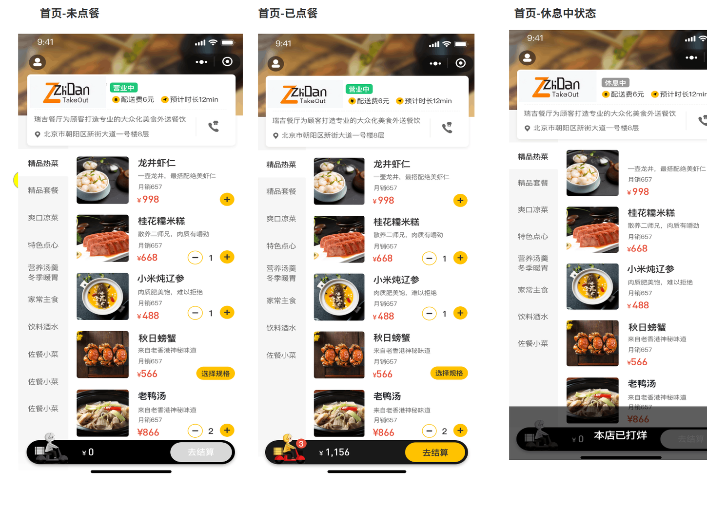
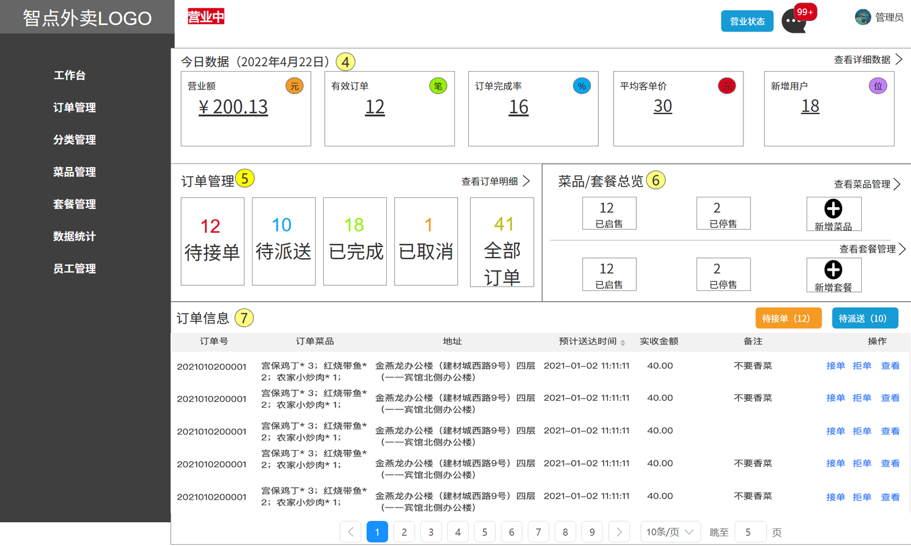
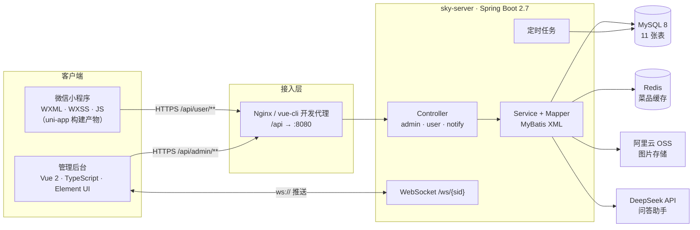
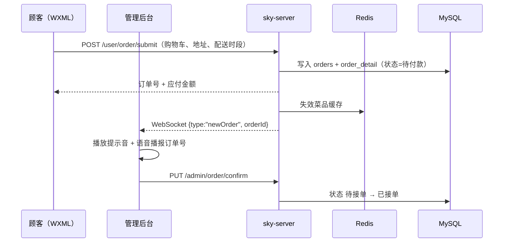
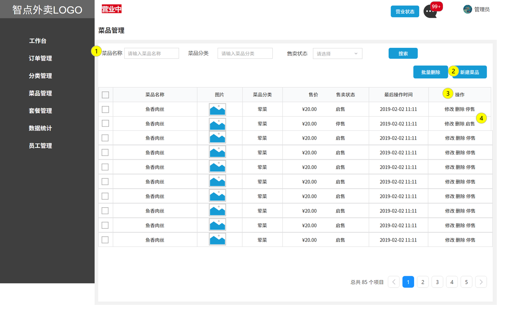
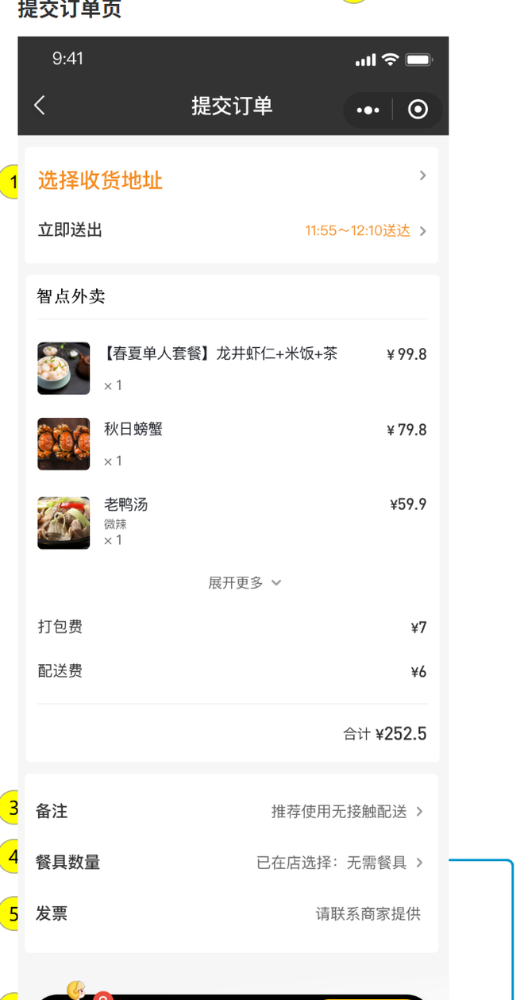
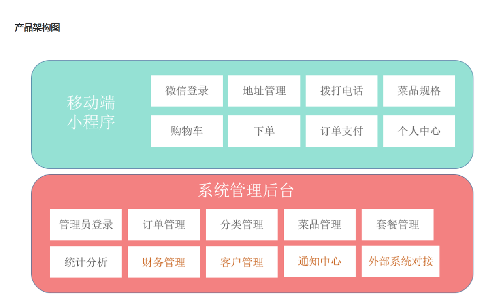
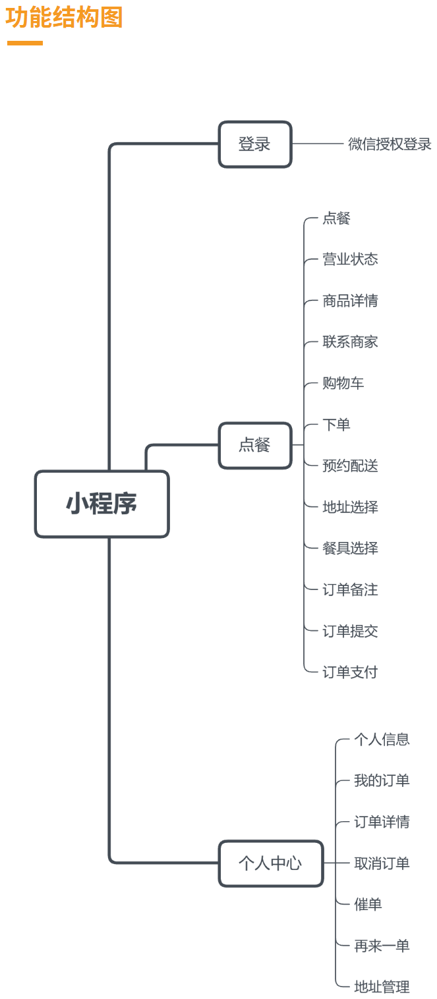
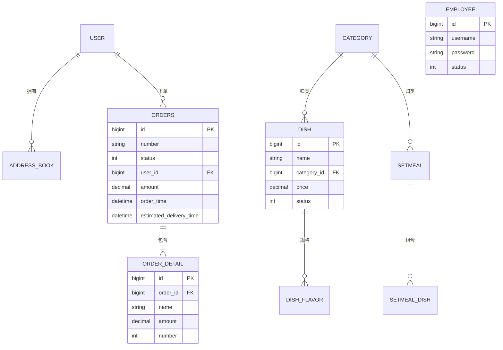

<div align="center">

# 智点外卖 · ZhiDian Takeout

**一套完整交付的外卖系统设计：从 BRD / MRD / PRD 与交互原型，到 Vue 管理后台、WXML 微信小程序，再到 Spring Boot 服务端。**

[](https://vuejs.org/)
[](https://www.typescriptlang.org/)
[](https://spring.io/projects/spring-boot)
[](https://www.mysql.com/)
[](https://developers.weixin.qq.com/miniprogram/dev/framework/)
[](LICENSE)

[English](README.md) · **简体中文**

[项目简介](#-项目简介) · [功能一览](#-功能一览) · [系统架构](#-系统架构) · [界面预览](#-界面预览) · [快速开始](#-快速开始) · [配置说明](#-配置说明) · [设计要点](#-设计要点) · [数据模型](#-数据模型) · [常见问题](#-常见问题)

</div>

<p align="center">
  
  
</p>

---

## 📌 项目简介

很多课程项目止步于「在我电脑上能跑」。这个仓库按产品的方式组织：需求文档、交互原型、两个客户端
和支撑它们的服务端放在一起，每一层都写到别人接手时不需要再问问题的程度。

系统是同一个交易场景的两个侧面：

| 角色 | 客户端 | 能做什么 |
| :-- | :-- | :-- |
| **顾客** | 微信小程序（`miniprogram/`，WXML/WXSS） | 浏览菜单、选择菜品规格、加购物车、选配送时间、下单支付、查看订单状态、再来一单 |
| **商家** | 管理后台（`admin-web/`，Vue 2 + TypeScript） | 查看今日营业额、接单/拒单、派送、维护菜品与套餐与分类与员工、看经营数据、使用内置问答助手 |

真正有意思的不是「又一个外卖 App」，而是**两个客户端如何共用同一套领域模型**，以及一些容易被
忽略的细节——店铺营业/休息状态、菜品规格影响价格、购物车角标、配送时间粒度、订单状态机——
如何在一个 Java 服务、一个浏览器后台和一个小程序之间保持一致。

<details>
<summary><b>哪些是这里做的，哪些是脚手架</b></summary>

<br/>

- **产品层** —— `docs/product/` 是本系统的 BRD、MRD、PRD；`docs/prototype/` 是 28 MB 的 Axure
  原型（用户端 + 管理端），含标注、页面流转图与功能结构图。
- **客户端** —— 管理后台基于开源项目 `vue-typescript-admin-template` 二次开发；业务页面、API 模块、
  订单流转、统计视图、语音提醒与问答页面属于本项目的工作。
- **服务端** —— `backend/` 沿用 `sky-take-out`（苍穹外卖）的教学架构；业务模块、订单状态机、定时任务、
  Redis 缓存失效策略与问答接口在此基础上做了扩展。
- **小程序** —— 以**编译后的 uni-app 产物**提交（`app.js`、`common/vendor.js`、`pages/**.wxml`）。
  这也是仓库标题里「Vue **和** WXML」的由来：管理端是 Vue，用户端是 WXML。用微信开发者工具
  直接打开即可，无需构建。

完整致谢见[致谢](#-致谢)。

</details>

---

## ✨ 功能一览

### 用户端 —— 微信小程序

| 模块 | 具体行为 |
| :-- | :-- |
| **授权登录** | 静默 `wx.login` 拿到 code，服务端换取 JWT；设备端不保存 openid |
| **店铺状态** | 首页三种形态——*营业中*、*已点餐/繁忙*、*休息中*，由店铺状态接口驱动；休息中禁止下单 |
| **点餐** | 左侧分类栏、右侧菜品；菜品可带规格（辣度/温度/份量），价格增量在进入购物车之前就算清 |
| **购物车** | 加/减/清空、数量角标、按规格分行，底部实时重算应付金额 |
| **结算** | 收货地址、**配送时间选择**（今天/明天，30 分钟一档）、订单备注、餐具份数、发票占位 |
| **支付** | 先建单再发起支付，支付成功页做幂等处理，刷新不会重复扣款 |
| **订单** | 按状态分栏（待付款/待接单/派送中/已完成/已取消）、取消、催单、「再来一单」回填购物车 |
| **我的** | 地址簿（新增/编辑/设为默认）、历史订单、联系商家 |

### 商家端 —— Vue 管理后台

| 模块 | 具体行为 |
| :-- | :-- |
| **工作台** | 今日营业额、有效订单、订单完成率、平均客单价、新增用户；各状态订单计数；菜品/套餐总览 |
| **订单管理** | 按状态筛选，接单、拒单（填原因）、派送、取消，查看订单明细与收货信息 |
| **菜品管理** | 菜品增删改查、图片上传、绑定分类、售价、起售/停售 |
| **套餐与分类** | 套餐由菜品组合而成；分类支持排序与增删改查 |
| **员工管理** | 员工增删改查、账号启用/禁用、重置密码 |
| **数据统计** | 营业额、用户增长、订单量、销量 Top10，时间范围可切换，ECharts 渲染 |
| **来单语音播报** | 布局层维持一条 WebSocket 连接，新订单到达时播放提示音并读出订单号，不必盯着屏幕 |
| **智点问答** | 对话界面，后端把最近 30 天的销量排行作为上下文传给大模型 |

### 服务端 —— Spring Boot

- 双 JWT 通道（管理端与用户端），密钥、请求头与有效期彼此独立
- 菜品列表 Redis 缓存，任何写操作按 pattern 批量失效
- 新订单 WebSocket 推送，配合未支付订单超时取消、派送中订单日终清理等定时任务
- 阿里云 OSS 上传、POI 报表导出、统一 `Result<T>` 返回体、全局异常处理
- `@AutoFill` + AOP 自动填充审计字段，用户上下文由 `ThreadLocal` 传递

---

## 🏗 系统架构



三条值得看清的链路：



---

## 🧰 技术栈

| 层次 | 选型 |
| :-- | :-- |
| 管理后台 | Vue 2.6、TypeScript 3.6、Element UI 2.12、Vuex + vuex-module-decorators、vue-router 3、axios、ECharts 5、SCSS、vue-cli 3 |
| 小程序 | uni-app 编译产物、WXML / WXSS / JS、微信开发者工具（基础库 2.24） |
| 服务端 | Java 8+、Spring Boot 2.7.3、MyBatis 2.2、Druid、PageHelper、Spring WebSocket、Spring Cache、Apache POI |
| 存储 | MySQL 8.0（utf8mb4）、Redis（逻辑库 10）、阿里云 OSS |
| 鉴权 | JWT，管理端与用户端双通道 |
| 智能问答 | DeepSeek `deepseek-chat`（OpenAI 兼容协议） |
| 文档 | BRD / MRD / PRD（docx）、Axure RP 交互原型 |
| 构建 | Maven 3.6+、npm 6+、Node 14/16 |

---

## 📁 目录结构

```
.
├── README.md                    ← 英文主版
├── README.zh-CN.md              ← 你正在看的这一份
├── LICENSE
├── backend/                     Spring Boot 服务端（Maven 多模块）
│   ├── pom.xml
│   ├── sky-common/              常量、异常、统一返回体、工具类
│   ├── sky-pojo/                实体、DTO、VO
│   └── sky-server/              控制器、服务、Mapper、定时任务、WebSocket
│       └── src/main/resources/
│           ├── application.yml          环境切换与占位配置
│           ├── application-dev.yml      所有密钥均从环境变量读取
│           ├── config.properties        问答接口（占位 Key）
│           └── mapper/*.xml             11 个 MyBatis 映射
├── admin-web/                   Vue 2 + TypeScript 管理后台
│   ├── src/api/                 10 个带类型的 API 模块
│   ├── src/views/               工作台、数据统计、订单、菜品、套餐、
│   │                            分类、员工、问答
│   ├── src/router.ts            以 meta 驱动的导航
│   ├── src/utils/request.ts     axios 封装（注入令牌、统一错误处理）
│   └── .env.development         开发代理 → http://localhost:8080/admin
├── miniprogram/                 微信小程序（uni-app 编译产物）
│   ├── pages/                   11 个页面 + Navbar 组件
│   ├── components/              共用 UI 组件
│   └── project.config.json      appid 已替换为 touristappid
├── database/
│   └── schema.sql               11 张表 + 演示数据（个人信息已脱敏）
└── docs/
    ├── images/                  本文所用的截图
    ├── product/                 BRD / MRD / PRD
    └── prototype/               Axure 原型，浏览器打开 index.html
```

---

## 🖼 界面预览

<table>
<tr>
<td width="50%"><br/><sub><b>菜品管理</b> —— 搜索、售卖状态、批量操作</sub></td>
<td width="50%"><br/><sub><b>提交订单</b> —— 地址、配送时段、餐具、发票</sub></td>
</tr>
<tr>
<td><br/><sub><b>产品架构图</b> —— 写代码之前先画清楚</sub></td>
<td><br/><sub><b>功能结构图</b> —— 用户端范围</sub></td>
</tr>
</table>

---

## 🚀 快速开始

不必把三端都跑起来。挑一行你关心的：

| 我想…… | 做这个 | 需要 |
| :-- | :-- | :-- |
| 看设计成果 | 用浏览器打开 `docs/prototype/智点外卖_用户端/index.html` | 浏览器 |
| 看管理后台 | 第 1 → 5 步 | Node + 后端 |
| 试小程序 | 第 1 → 4 步，再第 6 步 | 后端 + 微信开发者工具 |
| 读需求文档 | 打开 `docs/product/` 下三份文档 | Word / WPS |

### 0. 环境要求

| 工具 | 版本 | 说明 |
| :-- | :-- | :-- |
| JDK | 8 或 11 | Spring Boot 2.7 也能跑在 17 上，但 8/11 与锁定依赖最匹配 |
| Maven | 3.6+ | `mvn -v` |
| Node.js | 14 或 16 | vue-cli 3 与 node-sass 时代工具链对 Node 18+ 不友好 |
| MySQL | 8.0 | utf8mb4 |
| Redis | 5+ | 单机即可 |
| 微信开发者工具 | 1.05+ | 仅小程序需要 |

### 1. 克隆仓库

```bash
git clone https://github.com/wushaw1102/ZhiDianTakeout.git
cd ZhiDianTakeout
```

### 2. 建库并导入数据

```bash
mysql -u root -p -e "CREATE DATABASE IF NOT EXISTS sky_take_out DEFAULT CHARSET utf8mb4;"
mysql -u root -p sky_take_out < database/schema.sql
```

脚本含 11 张表、10 个分类、25 道菜品与 25 笔订单，首次启动即可在工作台和统计页看到图表。
所有手机号、身份证号与 openid 均为占位值，见[安全说明](#-安全说明)。

### 3. 启动 Redis

```bash
redis-server            # 或：docker run -p 6379:6379 redis:7-alpine
```

服务端使用逻辑库 **10**，由 `SKY_REDIS_DATABASE` 控制。

### 4. 把服务端指向你的环境

所有凭据都从环境变量读取，仓库里不保存任何真实密钥。

```bash
# bash / Git Bash
export SKY_DB_PASSWORD=你的MySQL密码
export SKY_REDIS_PASSWORD=
export SKY_OSS_ACCESS_KEY_ID=...        # 可选：仅图片上传需要
export SKY_OSS_ACCESS_KEY_SECRET=...
export SKY_OSS_BUCKET=...
export SKY_WECHAT_APPID=...             # 可选：仅 wx.login 需要
export SKY_WECHAT_SECRET=...
```

```powershell
# PowerShell
$env:SKY_DB_PASSWORD = "你的MySQL密码"
$env:SKY_REDIS_PASSWORD = ""
```

问答页面读取 `backend/sky-server/src/main/resources/config.properties`，想让助手真的回答，
把里面的占位 Key 换成你自己的。

### 5. 启动后端，再启动管理后台

```bash
cd backend
mvn clean package -DskipTests
java -jar sky-server/target/sky-server-1.0-SNAPSHOT.jar
# → http://localhost:8080   （接口文档：/doc.html）
```

```bash
cd admin-web
npm install
npm run serve
# → http://localhost:8888   （开发代理 /api → http://localhost:8080/admin）
```

用种子管理员账号登录：`admin` / `123456`（数据库里存的是 MD5，仅用于本地演示）。

### 6. 打开小程序

1. 微信开发者工具 → **导入项目** → 选择 `miniprogram/`
2. 填自己的 AppID，或保留 `touristappid` 使用游客模式预览
3. 打开 **不校验合法域名**（详情 → 本地设置），否则访问不到 `http://localhost:8080`
4. 服务端不在 8080 时，改 `miniprogram/common/vendor.js` 里的 `baseUrl`

提交的是构建产物，这一端没有 `npm install`，也没有编译步骤。

---

## ⚙️ 配置说明

| 变量 | 默认值 | 用途 |
| :-- | :-- | :-- |
| `SKY_DB_HOST` / `SKY_DB_PORT` | `localhost` / `3306` | MySQL 地址 |
| `SKY_DB_NAME` | `sky_take_out` | 数据库名 |
| `SKY_DB_USER` / `SKY_DB_PASSWORD` | `root` / `change-me` | MySQL 账号 |
| `SKY_REDIS_HOST` / `SKY_REDIS_PORT` | `localhost` / `6379` | Redis 地址 |
| `SKY_REDIS_PASSWORD` / `SKY_REDIS_DATABASE` | 空 / `10` | Redis 密码与逻辑库 |
| `SKY_OSS_*` | 空 | 阿里云 OSS（菜品图片） |
| `SKY_WECHAT_APPID` / `SKY_WECHAT_SECRET` | 空 | 小程序 code 换 openid |
| `VUE_APP_URL`（管理端） | `http://localhost:8080/admin` | 开发代理目标 |
| `VUE_APP_SOCKET_URL`（管理端） | `ws://localhost:8080/ws/` | 订单推送 |

JWT 密钥与有效期仍在 `application.yml`（`sky.jwt.*`），对外暴露前请先轮换。

---

## 🔌 接口一览

共 19 个控制器，按通道分组：

| 通道 | 前缀 | 代表接口 |
| :-- | :-- | :-- |
| 管理端 | `/admin/employee` | `POST /login`、`POST`、`GET /page`、`PUT`、`POST /status/{id}` |
| 管理端 | `/admin/category` | `GET /page`、`POST`、`PUT`、`DELETE`、`GET /list` |
| 管理端 | `/admin/dish` | `GET /page`、`POST`、`PUT`、`DELETE`、`POST /status/{id}`、`GET /list` |
| 管理端 | `/admin/setmeal` | `GET /page`、`POST`、`PUT`、`DELETE`、`POST /status/{id}` |
| 管理端 | `/admin/order` | `GET /conditionSearch`、`GET /statistics`、`PUT /confirm`、`PUT /rejection`、`PUT /cancel`、`PUT /delivery/{id}`、`GET /details/{id}` |
| 管理端 | `/admin/workspace` | `GET /businessData`、`GET /overviewOrders`、`GET /overviewDishes`、`GET /overviewSetmeals` |
| 管理端 | `/admin/report` | `GET /turnoverStatistics`、`GET /userStatistics`、`GET /ordersStatistics`、`GET /top10`、`GET /export` |
| 管理端 | `/admin/chat` | `POST` —— 问答，服务端自动附带销量上下文 |
| 管理端 | `/admin/common` | `POST /upload` —— OSS 上传 |
| 用户端 | `/user/user` | `POST /login`（wx code）、`GET /shop/status` |
| 用户端 | `/user/shoppingCart` | `POST /add`、`GET /list`、`POST /sub`、`DELETE /clean` |
| 用户端 | `/user/order` | `POST /submit`、`PUT /payment`、`GET /historyOrders`、`PUT /cancel/{id}`、`POST /repetition/{id}`、`GET /reminder/{id}` |
| 用户端 | `/user/addressBook` | `GET /list`、`POST`、`PUT`、`DELETE /{id}`、`PUT /default` |
| 支付回调 | `/notify/pay` | 支付结果通知 |

所有响应共用一个外壳——`{ "code": 1, "msg": null, "data": ... }`——因此 axios 封装与小程序的
请求工具可以用同一套逻辑处理失败。

---

## 🧠 设计要点

六个比其它任何决定都更影响代码的选择。

**1 · 两条互不相通的令牌通道。** 管理端与用户端用不同密钥、不同请求头（`token` 与
`authentication`）、不同有效期，由 `config/WebMvcConfiguration` 中两个拦截器分别把关。即使两端
共用一个域名，用户令牌也进不了 `/admin/**`。

**2 · 审计字段只写一次。** `@AutoFill` 注解配 `AutoFillAspect`，从请求线程上下文里取当前用户，
统一填 `create_time`、`update_time`、`create_user`、`update_user`。业务代码不再手写这些字段，
新增表时也不会漏。

**3 · 缓存失效故意「粗」。** 菜品列表按分类缓存；任何菜品、分类、套餐的写操作都按 key 前缀批量
失效，而不是精确删一个 key。菜单短暂失真比多一次查询糟糕得多。

**4 · 订单推送是旁路，不是事实来源。** 新订单通过 WebSocket 推送、由布局层的 `<audio>` 播报，
但工作台仍然会轮询订单列表。连接断了只是退化成手动刷新，流程不会卡死。

**5 · 时间在订单模型里是一等公民。** 顾客选的是 30 分钟粒度的配送时段；服务端在创建 15 分钟后
自动取消未支付订单，凌晨 1 点清理仍处于派送中的订单。两个任务都是幂等的，重启不会重复处理。

**6 · 助手是「有据可依」的，不是凭空生成。** 调模型之前，`ChatServiceImpl` 先查出最近 30 天的销量
排行，作为上下文注入；提示词同时明确「问题与销量无关时忽略这段数据」。于是「卖得最好的是什么」
这类问题落到数据库上，而不是模型想象里。

---

## 🗃 数据模型



订单状态机是让两个客户端保持同步的关键：

```
1 待付款 ──支付──▶ 2 待接单 ──接单──▶ 3 已接单 ──派送──▶ 4 派送中 ──▶ 5 已完成
      │                  │                  │
      └──超时 15 分钟──▶ 6 已取消 ◀──拒单────┘
```

---

## 📦 产品文档与原型

| 交付物 | 路径 | 内容 |
| :-- | :-- | :-- |
| BRD | `docs/product/BRD-商业需求文档.docx` | 市场背景、商业目标、干系人价值 |
| MRD | `docs/product/MRD-市场需求文档.docx` | 目标用户、竞品扫描、需求分析 |
| PRD | `docs/product/PRD-产品需求文档.docx` | 功能清单、页面清单、字段级规则 |
| 原型 · 用户端 | `docs/prototype/智点外卖_用户端/index.html` | 14 张标注页面（营业中/已点餐/休息中、购物车、结算、各订单状态）＋ 流转图与功能图 |
| 原型 · 管理端 | `docs/prototype/智点外卖_管理端/index.html` | 16 个页面：工作台、订单台、菜品/套餐编辑、员工、统计、空/异常状态 |

原型是 Axure 静态导出，直接用浏览器打开即可，不需要起服务。本文的截图就是从原型渲染出来的，
所以界面与文档能严格对上。

---

## ⚠️ 范围与限制

把话说清楚能省下所有人的时间：

- **小程序支付是桩实现。** 订单与支付回调都在，但没有绑定真实商户号，流程在本地闭环，不经过微信支付。
- **统计页用的是种子数据。** 图表是真的 ECharts 组件、读的是真接口，数字是演示数据，不是 25 家门店的历史。
- **原型里的统计画板是占位。** Axure 中写着「Axhub Charts」的位置，实际实现是
  `admin-web/src/views/statistics` 下的 ECharts 页面。
- **没有自动化测试。** 订单状态流转与价格计算集中在 service 层，是最该先补测试的地方。
- **小程序提交的是构建产物。** 改 WXML 可行，但要重新构建需要原始的 uni-app 源码工程。

---

## 🔒 安全说明

上传前，本地工作副本里出现过的凭据已全部清理：

| 原本在仓库里 | 现在 |
| :-- | :-- |
| 阿里云 OSS AccessKey / Secret | 改为 `SKY_OSS_*` 环境变量，默认空 |
| 微信 AppID / AppSecret | 改为 `SKY_WECHAT_*` 环境变量 |
| DeepSeek API Key | `config.properties` 中为占位值，运行时读取 |
| MySQL / Redis 密码 | 改为环境变量，默认值非敏感 |
| 小程序 AppID | 改为 `touristappid`（游客模式） |
| SQL 中的手机号、身份证号、openid | 替换为 `13800000000` / `110101199001010000` / `demo-openid-…` |
| 个人文件（简历、带学号姓名的报告） | **不在本仓库中** |

如果你 fork 后要填自己的密钥，请注意 `config.properties` 是被跟踪的（为了让项目开箱即用）。
更稳妥的做法是删掉它，改为导出 `DEEPSEEK_API_KEY` 环境变量，由运行时读取。

---

## 🗺 后续计划

- [ ] 把小程序 uni-app 源码抽到 `miniprogram-src/`，让 WXML 可以重新构建
- [ ] 绑定真实微信商户号，用 `wx.requestPayment` 替换支付桩
- [ ] 为订单状态机补集成测试（JUnit 5 + Testcontainers）
- [ ] 用 `docker-compose` 把 MySQL + Redis + 服务端 + Nginx 一键拉起
- [ ] 问答改为流式响应，并在菜单数据上增加一层检索

---

## 🙏 致谢

这个项目站在三个开源项目的肩膀上，写清楚来源是使用它们的一部分：

- **sky-take-out（苍穹外卖）** —— 服务端架构参照的 Spring Boot 教学项目，控制器、实体与配送领域
  模型由它起步并在本项目中扩展。
- **vue-typescript-admin-template**（Chong Guo，MIT）—— 管理后台外壳：布局、路由守卫、store 模块与
  构建配置；业务页面属于本项目。
- **uni-app** —— 小程序产物背后的编译器。
- **Axure RP** —— `docs/prototype/` 所用的原型格式。

---

## ❓ 常见问题

<details>
<summary><b>管理后台能打开，但所有请求都 404</b></summary>

<br/>

看 `admin-web/.env.development`：开发代理把 `/api` 转发到 `VUE_APP_URL`，这个值必须以 `/admin`
结尾（`http://localhost:8080/admin`），因为后端的管理端路由在这个前缀下，而代理会剥掉 `/api`。

</details>

<details>
<summary><b>用种子管理员登录提示「账号不存在」</b></summary>

<br/>

重新导入 `database/schema.sql`——员工数据在种子里。密码是 `123456` 的 MD5，如果改过盐值或重新
哈希过，请重新导入。

</details>

<details>
<summary><b>小程序白屏或报网络错误</b></summary>

<br/>

三个常见原因：后端不在 8080、开发者工具没开**不校验合法域名**、
`miniprogram/common/vendor.js` 里的 `baseUrl` 还指向别处。另外想拿到 `wx.login` 的 code，
需要填一个有效 AppID。

</details>

<details>
<summary><b>上传图片报 OSS 错误</b></summary>

<br/>

`SKY_OSS_*` 默认为空。要么导出真实凭据，要么跳过图片上传——SQL 种子里菜品已经带了图片地址。

</details>

<details>
<summary><b>为什么提交的是编译后的小程序，而不是源码？</b></summary>

<br/>

为了让仓库在没有 Node 工具链的情况下也能浏览和运行这一端。代价写在[范围与限制](#-范围与限制)里，
把 uni-app 源码抽出来是后续计划的第一项。

</details>

---

## 📄 许可证

[MIT](LICENSE) © 2026 wushaw1102。第三方声明附在许可证文件末尾。
